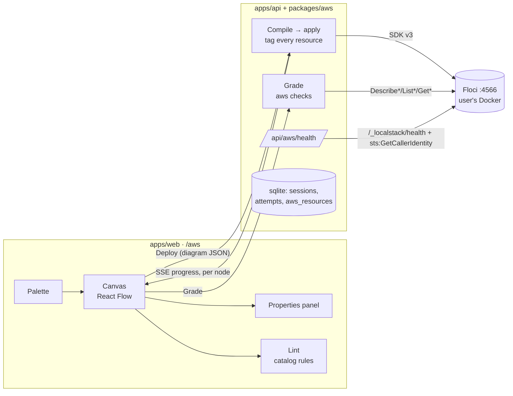

# ADR-0001: AWS Labs canvas mode, verified against Floci

**Status:** Proposed; deferred. CLI mode was built first (see the update below).
**Date:** 2026-10-21, updated 2026-10-22
**Deciders:** Ethan Donovan

## Update, 2026-10-22: spike results, and CLI mode first

The plan changed after the spikes: AWS Labs now ships **CLI mode only**, as ordinary scenarios like the Kubernetes ones, solved with the AWS CLI in a terminal. The canvas below is deferred. What was built:

- **Scenarios:** `track: aws`, `base: floci`, the four SAA-C03 domains, and an `aws` check type, a CLI command plus the existing `expect` operators. This replaces the SDK-call check type proposed below, so CLI mode and any later canvas share one kind of check.
- **Driver:** a Floci driver (`drivers/floci`) behind the existing `Driver` interface. A routing driver sends `floci` sessions to it and everything else to the VMs, so the session manager, grader, History, Focus, exam mode and `./cka dry-run`/`verify` needed no AWS-specific code.
- **Isolation:** each attempt gets a fresh 12-digit Floci account and a session-only AWS CLI config with dummy credentials. Reset means a new account. The endpoint must be on this machine.
- **Terminal:** the browser terminal is a local bash shell with that config, run in a pseudo-terminal by a small Python helper (`apps/api/src/pty-bridge.py`), since the repo avoids native modules such as node-pty.
- **Content:** ten scenarios, two or three per domain, each passing `./cka dry-run` (fails before the fix) and `./cka verify` (100% with the solution) against Floci 1.7.0.

### Spike results

Measured against Floci 1.7.0 (CLI 0.2.1) on Docker Desktop 29.3.1, with a 10-CPU, 8 GB Docker VM:

**1. Account isolation: yes.**

- A 12-digit access key becomes the account ID; any other key maps to `000000000000`.
- S3, SQS, EC2, DynamoDB, IAM and RDS resources are invisible across accounts.
- Quirks:
  - S3 bucket names are per account, not global.
  - Only the first account to touch EC2 gets a default VPC; `CreateDefaultVpc` in a later account makes one without subnets. Scenarios must not rely on the default VPC.
  - The snapshot API is not available in 1.7.0.
  - The Resource Groups Tagging API returns nothing, so a sweeper cannot use it.

**2. Deploy time and memory.**

- Speed:
  - A Floci call takes about 4 ms; each AWS CLI call adds about 620 ms of process start-up.
  - The three-tier diagram (VPC, 6 subnets, IGW, NAT, route tables, 3 SGs, ALB, target group, listener, launch template, ASG, DB subnet group, Multi-AZ RDS, S3 with lifecycle, Route 53 alias) took 60 s through the CLI. In-process SDK calls would take well under a second, apart from RDS.
- Container-backed services:
  - `CreateDBInstance` blocks while the database container starts: 28.4 s cold (26.2 s of it pulling `mysql:8.0.36`), about 0.5 s warm. Deleting takes about 5.5 s.
  - `RunInstances` returns at once with `pending`; an Alpine instance was running about 20 s later, including the image pull.
- Memory:
  - Floci itself: 144 MiB idle, 177 MiB after the deploy.
  - MySQL container: 359 MiB. Multi-AZ still runs a single container.
  - Alpine instance: about 5 MiB.
- Auto Scaling groups launch no instances in 1.7.0; the reconciler never started.
- The binary has `floci.services.{ec2,rds,ecs,elbv2}.mock` settings, presumably record-only modes. They were not tested.

**3. Describe fields.**

- All three example checks in this ADR evaluate as written:
  - RDS `MultiAZ`, and the DB subnet group's AZs;
  - the ALB's `AvailabilityZones` and subnets;
  - the app SG's `UserIdGroupPairs` equal to the ALB's SG.
- Also populated: route-table NAT and IGW targets, NAT subnet and state, S3 lifecycle rules, and Route 53 alias targets.
- Not stored: RDS `BackupRetentionPeriod`, `StorageEncrypted` and `DeletionProtection` (always `None`), and `SecondaryAvailabilityZone`. Target health is empty.
- Unsupported: `CreateDBInstanceReadReplica`, `DescribeDBEngineVersions`, `ModifyVpcEndpoint`, and the IAM account password policy.
- Works and is useful for grading: `iam simulate-principal-policy`, including wildcard resources and explicit denies.

**Validation (not a planned spike, but it changes the design).**

- Floci accepted all of the following, which AWS rejects:
  - a /8 or /29 VPC;
  - a subnet outside its VPC's CIDR, an overlapping subnet, and an unknown AZ;
  - a route to an unattached internet gateway;
  - a one-AZ DB subnet group;
  - security-group port 70000.
- It rejected only a one-subnet ALB and a duplicate security-group name.
- So lint is not an optimisation for a later canvas: it is the only thing enforcing AWS's rules. In CLI mode, checks compare exact values instead.

**For the canvas, when it is picked up again:**

- Deploy with an account per Deploy rather than teardown-and-reapply, since accounts are free and isolated. Only EC2 and RDS containers need removing.
- Expect deploys of a second or two, plus RDS start-up.
- Make the lint rules run against Floci state as well, so the same rules can grade a CLI answer.

## Context

AWS Labs (`/aws`) is a `ComingSoonApp` shell. The goal is practice for the AWS Solutions Architect Associate (SAA-C03) exam, whose four domains are all about *designing* architectures: secure (30%), resilient (26%), high-performing (24%) and cost-optimized (20%).

The plan is two ways to answer a scenario, picked before it starts:

- **Canvas mode** (build now): drag AWS services from a palette onto a canvas, nest them (an EC2 instance inside a subnet inside a VPC), connect them, and set their properties (CIDRs, ports, engines) in a side panel.
- **CLI mode** (later): a terminal with the `aws` CLI, like the Kubernetes labs.

Both run against [Floci](https://github.com/floci-io/floci), an MIT-licensed local AWS emulator the learner runs themselves on port 4566.

What Floci gives us, and what it doesn't:

- It speaks the real AWS wire protocols, so the AWS SDK v3 and the AWS CLI work unchanged with an endpoint override.
- EC2, RDS and Lambda start **real Docker containers**, so they need the Docker socket mounted. ELBv2, Route 53, CloudFront and Auto Scaling are control-plane only.
- Networking is mostly records. NAT gateways and peering are metadata, security groups are enforced only with an opt-in flag, and Route 53 doesn't resolve DNS. **We can grade configuration, not traffic.**
- It has no documented reset endpoint, and its default storage is in-memory, so state is lost when the container stops.
- It serves the LocalStack-compatible `GET /_localstack/health`.

Constraints from this repo:

- Scenarios are YAML validated by zod (`packages/schema`). Grading is "run something, then apply `Expect` operators to its output" (`packages/core/src/grader.ts`). History and Focus read the `attempts` and `check_results` tables.
- `Driver` and `SessionManager` are built around VMs (nodes, SSH, snapshots), and Floci has none of those.
- `Mode` already means `practice | mock | …`, so the canvas/CLI choice needs a different name.
- Pinned tool versions live in `config/versions.yaml`.

## Decision

1. **A canvas answer is compiled into AWS API calls, deployed to Floci, and graded by reading Floci's state.** Instant client-side lint catches what AWS itself would reject, and is never scored. (Option C below.)
2. **Only the API server talks to Floci**, through the AWS SDK v3 with an explicit endpoint and dummy credentials. The browser never calls Floci directly.
3. **Checks get a new `aws` type:** one read-only SDK call, a JMESPath query, and the existing `Expect` operators. Canvas mode and CLI mode share the same checks.
4. **The canvas is built on React Flow (`@xyflow/react`)**, driven by a service catalog that defines each node kind's fields, nesting rules, lint, compile step and delete step.
5. **The canvas/CLI choice is a new session field, `workspace: 'canvas' | 'cli'`**, separate from `mode`.

## Options considered: how canvas answers are verified

### Option A: grade the diagram locally, with no Floci in canvas mode

| Dimension | Assessment |
|---|---|
| Complexity | Low to medium: a rules engine over a graph, like the System Labs sims |
| Cost | No Docker; instant and offline |
| Fidelity | Only as good as our rules. Nothing AWS-real backs it. |
| Reuse for CLI mode | None. Every scenario needs a second set of checks. |

**Pros:** fastest feedback, works without Floci, deterministic.
**Cons:** Floci goes unused in canvas mode. Two grading systems mean two definitions of "correct" that will drift. Learners never see real AWS errors.

### Option B: deploy to Floci and grade Floci, with no local validation

| Dimension | Assessment |
|---|---|
| Complexity | Medium: compiler, applier, teardown |
| Cost | Deploys take seconds, more for container-backed EC2 and RDS |
| Fidelity | Real API behaviour, within Floci's limits |
| Reuse for CLI mode | Full: same checks, same state |

**Pros:** one source of truth, and the errors are real AWS errors.
**Cons:** every typo costs a deploy round-trip. A malformed diagram fails halfway through a deploy, and the error is hard to map back to a box on the canvas.

### Option C: local lint, then deploy to Floci and grade Floci (chosen)

The same as B, plus a client-side lint pass for structural errors before any deploy.

**Pros:** everything in B, plus instant feedback on what AWS would reject anyway, before any deploy. Grading stays on real state, and is shared with CLI mode.
**Cons:** the lint rules partly duplicate AWS validation. Keep them to the rules AWS enforces itself, never rules that hint at the answer.

### Supporting choice: canvas library

| | React Flow (`@xyflow/react` 12) | Hand-rolled SVG | tldraw / Excalidraw |
|---|---|---|---|
| Nesting (VPC > subnet > EC2) | Built in (`parentId`, `extent: 'parent'`) | Write it ourselves | Freeform; nothing is typed |
| Typed, validated connections | `isValidConnection`, custom handles | Write it ourselves | No |
| Pan, zoom, minimap, drag from a sidebar | Built in, with documented examples | Weeks of work | Built in |
| Licence | MIT | n/a | tldraw needs a licence key in production |
| React 19 | Yes | Yes | Yes |

React Flow is the only one that gives typed nodes, nesting and validated edges without building a diagram engine.

## Design



### Screen

```
┌──────────────┬───────────────────────────────────────────┬──────────────────┐
│ Task 1/3  ▾  │  Region us-east-1                          │ Subnet           │
│ ──────────── │  ┌─ VPC app-vpc 10.0.0.0/16 ────────────┐  │ Name  public-a   │
│ Networking   │  │ ┌ public-a (az-a) ┐ ┌ public-b (az-b)┐│  │ CIDR  10.0.1.0/24│
│  VPC         │  │ │ [NAT]           │ │                ││  │ AZ    a  ▾       │
│  Subnet      │  │ └─────────────────┘ └────────────────┘│  │ Route none|IGW|NAT│
│  IGW  NAT    │  │ ┌ app-a ──────────┐ ┌ app-b ─────────┐│  │                  │
│ Compute      │  │ │ [EC2]           │ │ [EC2]          ││  │ ⚠ overlaps       │
│  EC2  ASG    │  │ └─────────────────┘ └────────────────┘│  │   app-a          │
│  Lambda      │  │  [ALB] ──▶ EC2s     [RDS] ◀── EC2s    │  │                  │
│ Database     │  └───────────────────────────────────────┘  │                  │
│  RDS  Dynamo │  (Users) ──▶ [Route 53] ──▶ [ALB]           │                  │
│ …            │                                             │                  │
│              │  [Lint: 1 error]   [Deploy]   [Grade]       │                  │
└──────────────┴───────────────────────────────────────────┴──────────────────┘
```

### Diagram model (`packages/schema/src/aws/`, shared by web and API)

```ts
type ArchNode = { id: string; kind: NodeKind; parentId?: string; position: { x: number; y: number };
                  config: Record<string, unknown>; locked?: boolean };   // locked = given by the scenario
type ArchEdge = { id: string; source: string; target: string; config?: Record<string, unknown> };
type Diagram  = { nodes: ArchNode[]; edges: ArchEdge[] };
```

An edge's meaning is derived from its `(source.kind, target.kind)` pair and never stored, so it can't disagree with its endpoints.

**Placement rules:**

- **Single-subnet resources nest inside a subnet:** EC2, NAT gateway.
- **Multi-subnet resources sit in the VPC** and pick their subnets in the panel: ALB, Auto Scaling group, RDS (its DB subnet group), VPC-attached Lambda. Lint requires two or more AZs where AWS does.
- **Regional services sit outside any VPC:** S3, DynamoDB, SQS, SNS, Lambda, API Gateway, CloudFront, Route 53.
- **The AZ is a subnet field, not a container.** That keeps nesting to two levels, and each subnet is coloured by its AZ.
- **"Public" is never a checkbox.** A subnet has `route: none | igw | nat`, and lint requires the IGW or NAT to exist. That's how AWS defines a public subnet, and it's a classic exam trap.
- **`Users`** is a pseudo-node with no AWS resource: the source for internet-facing edges.

**Edges compile into the glue an architect would otherwise write by hand:**

| Edge | Compiles to |
|---|---|
| Users → ALB | ALB security group allows 0.0.0.0/0 on the listener port |
| ALB → EC2 / ASG | Target group, listener, registered targets; target SG allows **the ALB's SG** on the port |
| EC2 / ASG / Lambda → RDS | RDS SG allows the source SG on 3306/5432 |
| Route 53 → ALB / CloudFront | Hosted-zone alias A record |
| CloudFront → S3 / ALB | Distribution origin (plus OAC and a bucket policy for S3) |
| API Gateway → Lambda | Route/integration plus `lambda:AddPermission` |
| S3 → Lambda | Bucket notification plus permission |
| SQS → Lambda | Event source mapping |
| SNS → SQS | Subscription plus queue policy |
| Lambda / EC2 → S3 / DynamoDB / SQS / SNS | IAM role policy; the edge's `access: read \| write` picks the actions |

Every compute node gets its own security group, and edges add the rules between them. Chaining security groups this way, with least privilege, is the core of the "secure architectures" domain, and checks can assert it exactly.

### Service catalog (one entry per node kind)

```ts
interface CatalogEntry {
  kind: NodeKind; label: string; category: 'Networking' | 'Compute' | 'Database' | 'Storage' | 'Integration' | 'Edge';
  parent: 'region' | 'vpc' | 'subnet';
  fields: FieldSpec[];                 // text | cidr | select | number | bool | port | subnets; drives the panel
  lint(node, diagram): LintIssue[];    // what AWS would reject; runs in the browser
}
// Server side (packages/aws), keyed by the same kind:
interface Compiler { compile(node, diagram): Op[]; remove(physical): Op[] }   // Op = { nodeId, call, params }
```

Each new service costs one catalog entry, a compiler, a remover, and its edge rows. That's the main ongoing cost of this design (see Consequences).

**Lint** stays limited to what AWS would refuse: a subnet CIDR outside its VPC or overlapping a sibling; a VPC CIDR outside /16–/28; an ALB or DB subnet group spanning fewer than two AZs; a `route: igw` subnet in a VPC with no IGW; a NAT gateway outside a public subnet. Invalid edge pairs are refused at connect time with `isValidConnection`. Lint errors block Deploy. Lint never says whether the task is solved, so exam mode is unaffected.

### Deploy

`POST /api/aws/session/deploy` with the diagram:

1. Compile to ops, ordered by containment and then by edges.
2. Tear down this session's previous resources (from `aws_resources`, in reverse dependency order).
3. Apply the ops. Every resource gets the tags `cka-lab:session`, `cka-lab:node` and `Name`.
4. Stream progress over the existing session SSE. Each op carries its `nodeId`, so a Floci error lands as a red badge on the right box.

v1 is a clean redeploy every time. If container-backed EC2 or RDS makes that too slow, add incremental redeploys: hash each node's config, and recreate only changed nodes and their dependents.

### Grading: the `aws` check type

```yaml
- id: alb-two-azs
  type: aws
  description: The load balancer spans two Availability Zones
  call: elbv2.DescribeLoadBalancers
  params: { Names: [web-alb] }
  query: length(LoadBalancers[0].AvailabilityZones)
  expect: { gte: 2 }
- id: alb-sg
  type: aws
  description: Capture the ALB's security group
  call: elbv2.DescribeLoadBalancers
  params: { Names: [web-alb] }
  capture: { ALB_SG: "LoadBalancers[0].SecurityGroups[0]" }
  expect: { notEmpty: true }
- id: app-only-from-alb
  type: aws
  description: App servers accept port 80 only from the load balancer
  call: ec2.DescribeSecurityGroups
  params: { Filters: [{ Name: tag:Name, Values: [app-sg] }] }
  query: "SecurityGroups[0].IpPermissions[?FromPort==`80`].UserIdGroupPairs[].GroupId | [0]"
  expect: { equals: "${ALB_SG}" }
```

How these checks run:

- **Read-only:** `call` must match `/^\w+\.(Describe|List|Get)\w+$/`, so grading can never change state.
- **Output:** the query result is JSON-stringified, and strings are unquoted, then passed to the existing `evaluate()`. All `Expect` operators work unchanged. It's the same JMESPath as `aws … --query`, so authors can prototype checks in a terminal.
- **Captures:** run in order. `${VAR}` substitution reuses `renderDeep` from `packages/schema/src/vars.ts`. A check whose capture failed reports "depends on alb-sg".
- **Finding resources:** by `Name` tag or name, never by generated ID. Scenario text names the resources ("a VPC named `app-vpc`"), which also makes the same check work for a CLI-mode answer.

### Scenario format (`scenarios/aws/<domain>/<id>/scenario.yaml`)

A separate `AwsScenarioSchema`, not the Kubernetes one: `base`, `nodes` and node-targeted steps don't apply. It reuses `ExpectSchema`, `VariableSchema` (to randomise CIDRs and names) and the task, hint and points structure.

```yaml
id: ha-three-tier
title: Highly available three-tier web app
domain: resilient            # secure | resilient | performant | cost
difficulty: 2
estimatedMinutes: 25
workspaces: [canvas, cli]
services: [ec2, elbv2, rds, autoscaling]   # Start is disabled if Floci lacks any of them
palette: [users, vpc, subnet, igw, nat, alb, asg, ec2, rds, s3]   # may include distractors
given: { nodes: [...], edges: [...] }      # pre-existing infra; locked on the canvas, deployed at start in CLI mode
tasks: [ { id: q1, title: ..., points: 10, checks: [ ... ], hints: [ ... ] } ]
solution: { nodes: [...], edges: [...] }   # rendered read-only on "View solution"
```

`given` and `solution` are diagrams, so they're authored by drawing, then exporting the YAML from the canvas (a Studio action), not by typing coordinates.

### Floci connection and safety

- **Endpoint:** `CKA_FLOCI_URL`, default `http://localhost:4566`.
- **Health check:** `GET /api/aws/health` probes `/_localstack/health` for the service list, then calls `sts:GetCallerIdentity` to prove the protocol works. It returns `{ reachable, services, accountId }`.
- **Status in the UI:** the AWS home page shows a status pill and a "Start Floci" panel with the exact `docker run`, including the Docker socket mount EC2, RDS and Lambda need. The pill re-checks on window focus and before every deploy.
- **Pinned version:** `flociVersion` goes in `config/versions.yaml`, and the scenarios are tested against it.
- **Never real AWS.** Clients are always built with an explicit `endpoint` and static credentials (`test`/`test`), never the default credential chain. A non-loopback endpoint is refused unless `CKA_FLOCI_ALLOW_REMOTE=1` is set. Without this, a learner with real credentials in `~/.aws` and a wrong endpoint would launch real EC2 and RDS on their own bill. CLI mode will follow the same rule: the terminal sets `AWS_ENDPOINT_URL` and dummy keys, and unsets `AWS_PROFILE`.

### Sessions

The CKA `SessionManager` is VM-specific, so AWS gets an `AwsSessionManager` that:

- writes to the same `attempts` and `check_results` tables, so History and Focus work unchanged;
- adds a `workspace` column, while `mode` keeps its meaning, so practice, exam mode and blind grading carry over;
- autosaves the diagram server-side, debounced, because it *is* the answer: a page refresh or browser change mustn't lose it;
- can run alongside a CKA session, since they share no resources.

## Trade-off analysis

- **Fidelity vs. speed.** Grading Floci state is slower than grading a graph locally, but it's real AWS semantics, and it's the only way CLI mode gets the same checks for free. Lint gets back most of the speed for the commonest mistakes.
- **Configuration, not traffic.** Floci records NAT routes and peering and doesn't route through them, and Route 53 doesn't resolve. So "requests from the private subnet reach the internet via NAT" is checked as "the private route table sends 0.0.0.0/0 to a NAT gateway in a public subnet". That's how the exam tests it anyway: SAA-C03 asks which design is right, not whether packets flow.
- **Edges that compile to glue** make the canvas far more expressive than boxes and arrows, and teach the security-group and IAM wiring architects forget. The cost is that each edge type is real code with real Floci calls.
- **A separate scenario schema** costs some duplication with `ScenarioSchema`. Forcing AWS into a schema that requires `base`, `nodes` and SSH steps would cost more.

## Consequences

**Easier:**

- CLI mode becomes mostly a terminal with AWS env vars, plus deploying `given` at start. The scenarios and checks already work.
- Authoring is drawing: build the solution on the canvas, export it, and write checks against what it deployed.
- History, Focus, exam mode and blind grading come along through the shared tables.

**Harder:**

- Every service means catalog, lint, compile and remove code, and Floci updates can break it. Mitigate by pinning the Floci version and running a CI smoke test that deploys each scenario's `solution` and expects full marks.
- The learner's laptop runs real containers for EC2, RDS and Lambda, so a big diagram is slow and memory-hungry. Scenarios should cap instance counts.
- No reset endpoint means teardown correctness is our job. A leaked resource can make a later check pass by accident, which is why checks match on session tags.

**To revisit:**

- If Floci isolates state by account ID derived from the access key (as LocalStack does), switch to an account per session and drop most of the teardown logic.
- If a service's Floci fidelity is too thin to grade, grade that node kind locally and mark it in the catalog.
- If redeploys pass ~15 s for typical scenarios, build the incremental redeploys.

## Action items

**Spikes (do first; their answers can change the design):**

1. [x] Does Floci derive the account from a 12-digit access key, giving isolated state per session? Yes; see the update.
2. [x] Time and memory to deploy a three-tier diagram (2 AZs, ASG of 2, ALB, Multi-AZ RDS). Measured; see the update. The record-only (`mock`) settings are still untested.
3. [x] Do `DescribeDBInstances.MultiAZ`, ALB `AvailabilityZones`, SG `UserIdGroupPairs` and route-table NAT targets come back populated? Yes, all of them.
4. [ ] Check AWS Architecture Icons' usage terms before bundling them; plain coloured badges are fine to start with.

**Phase 1, connection:**

5. [ ] `packages/aws`: Floci client factory with the endpoint and credentials guard, plus `/api/aws/health`.
6. [ ] Replace `ComingSoonApp` for `/aws` with an AWS shell: status pill, setup panel, scenario list. Add `flociVersion` to `config/versions.yaml` and a Floci section to `docs/setup.md`.

**Phase 2, canvas with no Floci yet:**

7. [ ] Diagram schema and catalog in `packages/schema/src/aws/` for Users, VPC, Subnet, IGW, NAT, EC2, ALB, RDS and S3.
8. [ ] React Flow canvas: palette drag and drop, nesting, typed edges, properties panel, lint panel, server-side autosave.
9. [ ] Workspace picker on Start, with Canvas enabled and CLI shown as "coming soon".

**Phase 3, deploy and grade:**

10. [ ] Compiler, applier and remover; `aws_resources` table; per-node SSE progress and error badges.
11. [ ] `aws` check type with captures; `AwsScenarioSchema`; `AwsSessionManager` writing attempts.
12. [ ] Three scenarios: public/private subnets with NAT (resilient), ALB+ASG+RDS with chained SGs (secure), S3 lifecycle to Glacier (cost).
13. [ ] CI smoke test: deploy each `solution`, assert 100%.

**Phase 4 and later:**

14. [ ] Lambda, API Gateway, SQS/SNS, DynamoDB, CloudFront, Route 53; a "View solution" diagram; "Show CLI equivalent" for each op, which leads into CLI mode.
15. [x] CLI mode: terminal with the AWS env vars, scenario setup at start, `aws` checks. Built first, with ten scenarios (2026-10-22).
